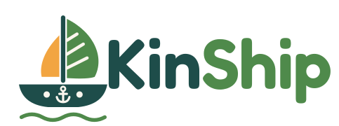

<h1 align="center">
  <picture>
    <source media="(prefers-color-scheme: dark)" srcset="docs/assets/kinship-logo-horizontal-reversed.svg">
    
  </picture>
</h1>

<p align="center"><strong>Family history without the cloud</strong></p>

Self-hosted family tree for families: relationships, sources, photos, private health history and DNA results. Runs with Docker Compose (PostgreSQL, a TypeScript API, a React UI behind nginx). Licensed under AGPL-3.0-or-later.

> **Status: alpha.** You can install it, set up an account and sign in, add people and relationships, and see them on a family tree chart you can pan and zoom. Release 0.1 ("It runs") is being finished; the other chart views come later. **Data may be wiped between 0.1.x releases: do not enter real family data.**

## Install

Install it with Docker Compose from the published images: see **[INSTALL.md](INSTALL.md)** (install, first run, recovery, update, backup). The first run needs a one-time setup token that the `api` container prints in its log:

```sh
docker compose logs api     # look for "KinShip is not set up yet"
```

To work on KinShip itself, use the development stack instead: `docker compose -f compose.dev.yml up --build`, then open <http://localhost:5173> (see [CONTRIBUTING.md](CONTRIBUTING.md)).

## Locked out? Set a new password

There is no email yet, so whoever runs the server can set a new password from the command line. It asks for the password twice (nothing is shown) and signs that account out everywhere:

```sh
docker compose exec -it api kinship set-password you@example.com
```

For scripts, pipe the password in instead: `printf '%s' "$NEW_PASSWORD" | docker compose exec -T api kinship set-password you@example.com --password-stdin`. The command exists only inside the container; it is not reachable over HTTP.

## Where to look

- [`design/`](design/) holds the approved UI mockup (`kinship-mockup.html`, with a fictional sample family) and the requirement docs. Start with [`design/kinship-v2-requirements.md`](design/kinship-v2-requirements.md).
- [`design/kinship-release-and-deployment-plan.md`](design/kinship-release-and-deployment-plan.md) says what ships in which version, how images are built and how upgrades work.
- [`docs/decisions/`](docs/decisions/) records the technical decisions (the stack is in [0001](docs/decisions/0001-stack.md); releases and images in [0004](docs/decisions/0004-release-and-images.md)).
- [CHANGELOG.md](CHANGELOG.md) lists what each release includes.

## Contributing and security

- [CONTRIBUTING.md](CONTRIBUTING.md): how to propose changes (Conventional Commits, DCO sign-off).
- [SECURITY.md](SECURITY.md): how to report a vulnerability privately.
- [CODE_OF_CONDUCT.md](CODE_OF_CONDUCT.md) and [TRADEMARK.md](TRADEMARK.md).

## License

[AGPL-3.0-or-later](LICENSE). If you run a modified copy of KinShip as a network service, you must offer your users the source of your changes. The KinShip name and logo are not covered by this license; see [TRADEMARK.md](TRADEMARK.md).
