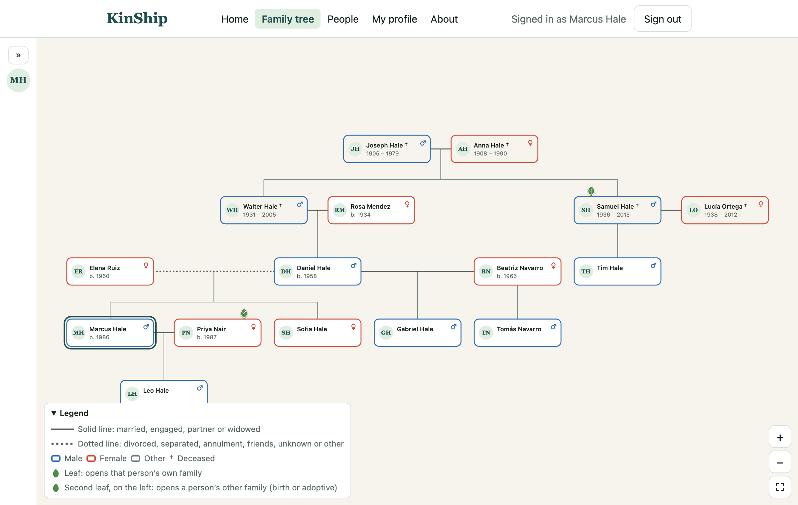
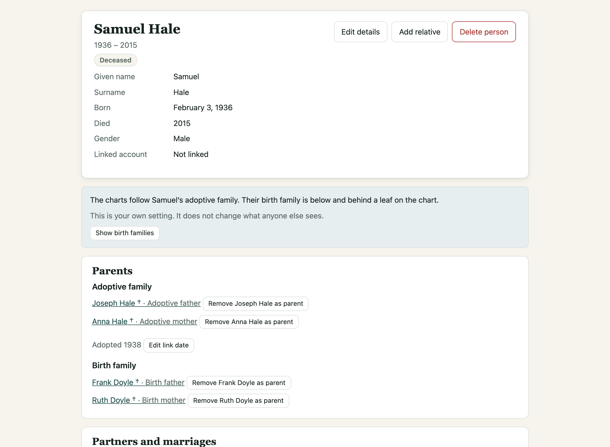

<h1 align="center">
  <picture>
    <source media="(prefers-color-scheme: dark)" srcset="docs/assets/kinship-logo-horizontal-reversed.svg">
    
  </picture>
</h1>

<p align="center"><strong>Family history without the cloud</strong></p>

Self-hosted family tree for families: relationships, sources, photos, private health history and DNA results. Runs with Docker Compose (PostgreSQL, a TypeScript API, a React UI behind nginx). Licensed under AGPL-3.0-or-later.

> **Status: 0.2 ("A tree you can trust") is the first release with the data promise.** You can install it, set up with a seven-step wizard, invite people and link their accounts to people on the tree, add people and relationships (with birth and adoptive parents, names, step relatives and custom labels), and see them on a family tree chart you can pan and zoom. **From 0.2 upgrades keep your data** and backups are built in; the 0.1 alphas had no such promise. Photos, the other chart views, reports and email come later (see the release plan).

<p align="center">
  <picture>
    <source media="(prefers-color-scheme: dark)" srcset="docs/assets/screenshots/tree-dark.png">
    
  </picture>
</p>

<p align="center">
  
</p>

<sub>Screenshots show the fictional Hale family. More are in [`docs/assets/screenshots/`](docs/assets/screenshots/).</sub>

## Install

Install it with Docker Compose from the published images: see **[INSTALL.md](INSTALL.md)** (install, first run, recovery, update, backup). Backups are built in (encrypted, scheduled, with a test and a command-line restore; see INSTALL.md). **Admin → Updates** tells the SuperAdmin when a new version is out (a daily read of GitHub's public release list, sending nothing about your install; it can be switched off) and shows what changes, with a backup warning; every admin sees a "What's new" popup after an update. The first run is a seven-step setup wizard (account, tree, you, and optionally a partner, parents and children) and needs a one-time setup token that the `api` container prints in its log:

```sh
docker compose logs api     # look for "KinShip is not set up yet"
```

To work on KinShip itself, use the development stack instead: `docker compose -f compose.dev.yml up --build`, then open <http://localhost:5173> (see [CONTRIBUTING.md](CONTRIBUTING.md)).

## Inviting people, and locked out?

Admins invite people under **account menu → Admin → Users** by copying a link (see [INSTALL.md](INSTALL.md)); an admin can also make a set-password link for someone who is locked out, and the account shows that an admin set it. A SuperAdmin who is locked out, or anyone when no admin can sign in, uses the command line: there is no email yet, so whoever runs the server can set a new password from the command line. It asks for the password twice (nothing is shown) and signs that account out everywhere:

```sh
docker compose exec -it api kinship set-password you@example.com
```

For scripts, pipe the password in instead: `printf '%s' "$NEW_PASSWORD" | docker compose exec -T api kinship set-password you@example.com --password-stdin`. The command exists only inside the container; it is not reachable over HTTP.

## Where to look

- [`design/`](design/) holds the approved UI mockup (`kinship-mockup.html`, with a fictional sample family) and the requirement docs. Start with [`design/kinship-v2-requirements.md`](design/kinship-v2-requirements.md).
- [`design/kinship-release-and-deployment-plan.md`](design/kinship-release-and-deployment-plan.md) says what ships in which version, how images are built and how upgrades work.
- [`docs/decisions/`](docs/decisions/) records the technical decisions (the stack is in [0001](docs/decisions/0001-stack.md); releases and images in [0004](docs/decisions/0004-release-and-images.md)).
- [CHANGELOG.md](CHANGELOG.md) lists what each release includes.

## Contributing and security

- [CONTRIBUTING.md](CONTRIBUTING.md): how to propose changes (Conventional Commits, DCO sign-off).
- [SECURITY.md](SECURITY.md): how to report a vulnerability privately.
- [CODE_OF_CONDUCT.md](CODE_OF_CONDUCT.md) and [TRADEMARK.md](TRADEMARK.md).

## License

[AGPL-3.0-or-later](LICENSE). If you run a modified copy of KinShip as a network service, you must offer your users the source of your changes. The KinShip name and logo are not covered by this license; see [TRADEMARK.md](TRADEMARK.md).
